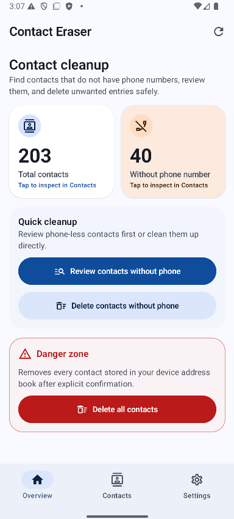
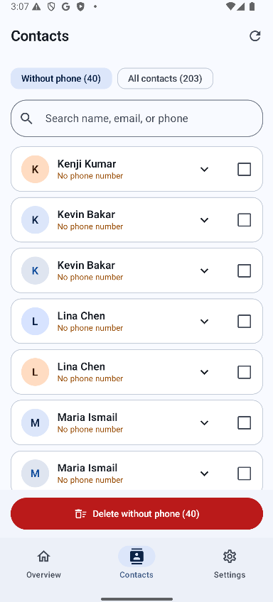
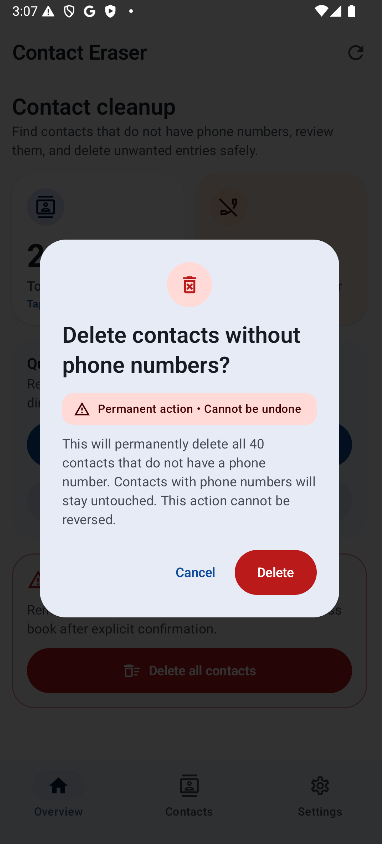

# Introduction

**Contact Eraser** is an open-source Android application designed to quickly identify, review, and safely delete phone-less contacts or wipe the entire address book with multi-layered safety confirmations.

## Overview

Over time, synced accounts (such as email, messaging apps, and enterprise suites) frequently clutter an Android device's address book with hundreds of orphaned entries that lack phone numbers. **Contact Eraser** solves this problem by providing a focused, clean utility for managing and purging unwanted contact records. Whether you need to filter and clean up entries missing telephone numbers, select and delete specific records in bulk, or perform a complete contacts wipe when resetting or decommissioning a device, Contact Eraser makes the process effortless and secure.

### Key Functionality & Features

- **Dashboard & Contact Health Overview**:
  - Live animated metric counters reporting **Total Contacts** and contacts **Without phone number**.
  - One-tap quick cleanup actions to directly review or remove phone-less entries.
  - Dedicated "Danger zone" section for bulk operations and complete address book erasure.

- **Smart Browsing, Filtering & Search**:
  - Fast filter chips to toggle between **Without phone** and **All contacts** with dynamic counts.
  - Real-time search across contact names, phone numbers, and email addresses.
  - Expandable contact cards showing detailed metadata, including Contact ID, Lookup key, and associated phone/email addresses.

- **Batch Selection & Precision Control**:
  - Intuitive multi-selection mode with individual contact checkboxes.
  - One-click bulk selection (*Select all visible contacts*) and clear selection controls.
  - Targeted deletion for only selected contacts or all phone-less contacts in one action.

- **Robust Deletion Safeguards**:
  - Permanent deletion warnings highlighting that operations cannot be undone.
  - Explicit confirmation dialogs tailored to each action (selected contacts, phone-less contacts, or all contacts).
  - Explicit acknowledgment checkbox required prior to triggering a full address book wipe.
  - Real-time animated progress dialog tracking batch deletion count (*Deleting X of Y*).

- **Modern Material 3 & Responsive Experience**:
  - Built 100% in Kotlin and Jetpack Compose utilizing Google's latest Material 3 Expressive design tokens.
  - Adaptive layout support: Bottom navigation bar for standard phone screens and responsive Navigation Rail for tablets, foldables, and landscape orientations.
  - Persisted theme settings: Switch seamlessly between System Default, Light, and Dark modes via Jetpack DataStore Preferences.

- **Transparent Permissions Management**:
  - In-app permission inspector displaying real-time status for `READ_CONTACTS` and `WRITE_CONTACTS`.
  - Contextual permission rationale banners with direct links to system app settings when permissions are denied.

### Technical Stack & Architecture

- **Language & Platform**: Kotlin 2.1+, Android SDK (Min SDK 29, Target SDK 37)
- **UI Framework**: Jetpack Compose & Material 3 (Compose BOM `2026.09.00`, Material 3 `1.5.0`)
- **Architecture**: Clean Architecture / MVI with `ViewModel`, Kotlin Coroutines, and `StateFlow`
- **Data Persistence**: AndroidX DataStore Preferences for theme settings
- **Testing**: Unit tests with JUnit 4 & Coroutines Test; Android instrumentation UI tests with Compose Test & Espresso

## Screenshots

| Overview & Dashboard | Contact Review & Selection | Deletion Confirmation |
| :---: | :---: | :---: |
|  |  |  |

## Credits

- **Author & Maintainer**: [Mohammad Hafiz bin Ismail (mypapit)](https://github.com/mypapit) — <mypapit@gmail.com>
- **Open Source Libraries & Frameworks**:
  - [Android Jetpack](https://developer.android.com/jetpack) (Compose, Navigation, Lifecycle, DataStore)
  - [Material 3](https://m3.material.io/) design system components
  - [Kotlin Coroutines](https://github.com/Kotlin/kotlinx.coroutines)
- **Downloads**:
  - [Get it on Google Play](https://play.google.com/store/apps/details?id=contacteraser.mobile.mypapit.net.contacteraser)

## Licensing

Contact Eraser is open-source software licensed under the **BSD 3-Clause License**.

```
Copyright (c) 2016-2026, Mohammad Hafiz bin Ismail (mypapit)
All rights reserved.

Redistribution and use in source and binary forms, with or without
modification, are permitted provided that the following conditions are met:

1. Redistributions of source code must retain the above copyright notice, this
   list of conditions and the following disclaimer.

2. Redistributions in binary form must reproduce the above copyright notice,
   this list of conditions and the following disclaimer in the documentation
   and/or other materials provided with the distribution.

3. Neither the name of deletecontacts nor the names of its
   contributors may be used to endorse or promote products derived from
   this software without specific prior written permission.

THIS SOFTWARE IS PROVIDED BY THE COPYRIGHT HOLDERS AND CONTRIBUTORS "AS IS"
AND ANY EXPRESS OR IMPLIED WARRANTIES, INCLUDING, BUT NOT LIMITED TO, THE
IMPLIED WARRANTIES OF MERCHANTABILITY AND FITNESS FOR A PARTICULAR PURPOSE ARE
DISCLAIMED. IN NO EVENT SHALL THE COPYRIGHT HOLDER OR CONTRIBUTORS BE LIABLE
FOR ANY DIRECT, INDIRECT, INCIDENTAL, SPECIAL, EXEMPLARY, OR CONSEQUENTIAL
DAMAGES (INCLUDING, BUT NOT LIMITED TO, PROCUREMENT OF SUBSTITUTE GOODS OR
SERVICES; LOSS OF USE, DATA, OR PROFITS; OR BUSINESS INTERRUPTION) HOWEVER
CAUSED AND ON ANY THEORY OF LIABILITY, WHETHER IN CONTRACT, STRICT LIABILITY,
OR TORT (INCLUDING NEGLIGENCE OR OTHERWISE) ARISING IN ANY WAY OUT OF THE USE
OF THIS SOFTWARE, EVEN IF ADVISED OF THE POSSIBILITY OF SUCH DAMAGE.
```
